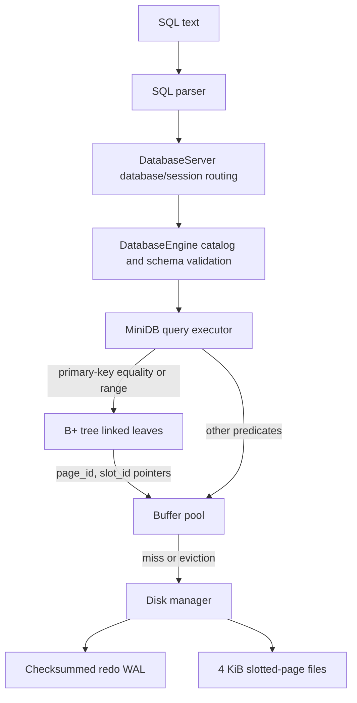

# MiniDB Architecture

MiniDB is a small, single-threaded relational engine. `DatabaseServer` provides the database session layer (`CREATE DATABASE`, `SHOW DATABASES`, `USE`); it selects a `DatabaseEngine` with its own persistent table catalog. Each `DatabaseEngine` dispatches statements to a `MiniDB` instance per table. Each instance stores records in fixed-size slotted pages and maintains an in-memory B+ tree for its primary-key column.

| Layer | Responsibility |
| --- | --- |
| `sql_parser.py` | Converts the supported SQL subset into query objects. |
| `database_engine.py` | `DatabaseServer` routes database commands and sessions; `DatabaseEngine` persists schemas, validates names/types, manages tables, and exposes dashboards. |
| `database.py` | Inserts, scans, selects, updates, deletes, aggregates, and rebuilds the primary-key index. |
| `bplustree.py` | In-memory ordered key-to-pointer index with equality and bounded range lookup. |
| `buffer_pool_manager.py` | Frame management, pin counts, dirty writeback, metrics, LRU/Clock replacement. |
| `disk_manager.py` | Fixed-size page I/O, WAL recovery, replay, and checkpoints. |
| `page.py` | Slotted-page storage, serialization, and header/slot validation. |
| `web_app.py` | Local multi-database browser workbench using persistent catalogs. |
| `cli.py` | Interactive SQL session with database switching. |
| `benchmark_pollution.py` | Four workload configurations, five seeds, and CSV summaries. |

## Write-ahead log and page recovery

Each per-table WAL entry stores a signature, page ID, CRC32 checksum, and complete 4 KiB page image. Dirty page images are flushed to the WAL before a buffer frame is unpinned; startup replays valid entries and truncates an incomplete tail. Checkpointing flushes all dirty database pages to stable storage before clearing the WAL. A size threshold triggers a buffer-pool checkpoint to bound log growth. Catalog JSON updates use a temporary file and atomic replacement.

This provides redo recovery for page images. It is not a transaction commit log: crashes during multi-page statements or active transactions may recover only some of their pages. There is no undo/redo transaction protocol yet.

## Indexed range lookup

For a range predicate on the indexed column (for example, `id >= 10 AND id < 20`), the B+ tree descends to the first matching leaf, then follows `next_leaf` pointers until the upper bound is passed. A conjunction can combine range bounds and then filter additional conditions. OR predicates and unsupported index operators fall back to a page scan.

## Cache-pollution experiment

The benchmark runs baseline, larger-hot-set, longer-scan, and larger-pool configurations. Each configuration is repeated with seeds 42–46. Within each run, the same generated hot-query trace and sequential cold-page scan are replayed for LRU and Clock. `cache_pollution_summary.csv` reports mean and sample standard deviation for overall and hot-query hit rates; `cache_pollution_timeline.csv` retains per-iteration values.

The experiment is synthetic and supports comparisons within each stated configuration. It does not establish a universal ranking. Small timing differences are not interpreted because the runs are too short for stable timing measurements.

## Persistence and scope

Each database has its own atomically replaced `catalog.json`; each table has a separate page file and redo WAL. WAL records contain checksummed full-page images and are replayed on startup before the B+ tree is rebuilt. The `default` database keeps the original catalog location, while newly created databases live under `databases/<name>/`. The primary-key B+ tree is rebuilt from data pages at startup. The engine provides single-database snapshot transactions for the running process, with `BEGIN`, `COMMIT`, and `ROLLBACK`; errors automatically roll back an active transaction. The browser reports transaction state and SQL errors include statement, line, and column context. WAL recovery is page-level redo, not full transaction recovery: there is no undo log or commit protocol, so a crash during a multi-page transaction can leave a partially applied transaction. Concurrent isolation, joins, NULL/default values, and index-file persistence are also out of scope.
