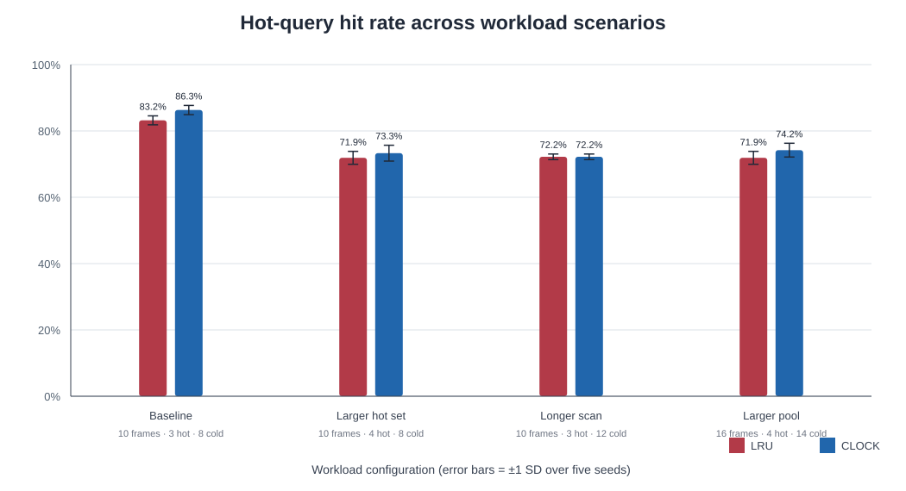

# MiniDB: A Lightweight Relational Database Engine with Buffer Pool Cache Pollution Analysis and Comparative Eviction Strategies

- **Course:** ____________________
- **Student:** ____________________
- **Institution:** ____________________
- **Date:** ____________________

## Abstract

MiniDB is an educational relational database engine implemented in Python. It connects a restricted SQL parser and executor to slotted-page storage, a buffer pool, and a B+ tree primary-key index. The engine supports schema validation, isolated named databases, multi-table data, equality and indexed range lookups, per-table checksummed redo WAL with startup replay, atomic catalog replacement, and a local browser workbench. The SQL session layer supports `CREATE DATABASE`, `SHOW DATABASES`, and `USE` in both the command-line shell and browser editor. A repeatable cache-pollution suite compares LRU and Clock under four hot-query/sequential-scan configurations and five fixed seeds. The results show that policy outcomes depend on the workload: Clock has higher average hit rates in three tested configurations, while the longer-scan configuration produces identical averages. These experiments illustrate workload sensitivity and do not establish that either policy is universally superior. MiniDB remains single-threaded. Its WAL replays page images after restart, but it does not provide crash-atomic multi-page transactions, concurrent isolation, joins, NULL/default values, or persistent index pages.

## 1. Introduction

A database query passes through a parser, an execution path, an index or page scan, a memory buffer, and disk storage. This project implements those stages in a small engine so their interactions can be inspected directly.

A sequential scan can cause **buffer-pool cache pollution** when cold scan pages displace pages that a workload will request again soon. MiniDB demonstrates this behavior and compares LRU with Clock (second chance) under repeatable workloads.

## 2. Objectives

1. Store variable-length records in fixed-size slotted pages and persist them to page files.
2. Manage a bounded buffer pool with pin counts, dirty-page writeback, and metrics.
3. Implement LRU and Clock replacement behind the same buffer-pool interface.
4. Index primary-key equality and range lookups with a B+ tree.
5. Parse and execute a small relational SQL subset with schema and type checks.
6. Measure how cold scans affect hot-query cache hits across several controlled workloads.
7. Expose multiple catalog tables and engine state through a local browser workbench.

## 3. Scope

MiniDB supports multiple tables through a persistent catalog and one page file per table. Its SQL subset includes table creation/removal, schema inspection, inserts, selects, updates, deletes, filters, ordering, limits, and simple aggregates/grouping. Inserts must provide every declared column. INT/INTEGER and TEXT values are validated. Primary-key equality and range predicates use the B+ tree; other predicates scan pages.

The engine is single-process and single-threaded. It implements checksummed page-level redo logging and startup replay, but not transaction-level crash atomicity, WAL undo, concurrent isolation, joins, NULL/default values, or persistent index pages. The SQL parser intentionally handles a small grammar.

## 4. Architecture and implementation

### 4.1 Parsing, schemas, and execution

`SQLParser` converts supported statements into query objects. `DatabaseEngine` manages the catalog and validates projected, grouped, filtered, updated, and inserted columns and values against the table schema. It routes the statement to the table’s `MiniDB` executor. Primary-key lookups use the B+ tree; other predicates scan pages.

### 4.2 Storage and buffer pool

The disk manager allocates fixed 4 KiB pages. A slotted page stores record bytes and a slot directory; deletion tombstones a slot for reuse. Deserialization checks page size, header bounds, slot bounds, record overlap, and page identity. The buffer pool tracks page IDs, frames, pin counts, dirty pages, hits, and misses. Dirty pages are written back before eviction or close.

### 4.3 B+ tree range lookup

B+ tree leaf nodes retain `next_leaf` links. A range query descends to the leaf where the lower bound belongs, then walks adjacent leaves until it passes the upper bound. For an AND predicate, indexed bounds are combined and remaining conditions are evaluated on candidate rows. OR predicates use the scan path.

### 4.4 Browser workbench

`web_app.py` uses the same persistent `DatabaseEngine` catalog as the command-line interface. A table picker selects among catalog tables; the table explorer shows its rows and schema, and the engine monitor shows that table’s B+ tree and buffer state. The sample-data button loads the example `users` rows idempotently.

## 5. Cache-pollution experiment

### 5.1 Method

The suite runs four buffer-pool configurations, each with five deterministic seeds (42–46). Each run has 20 iterations and ten hot-page requests per iteration. The hot request trace is generated once per seed and replayed unchanged for both policies. Each iteration accesses hot pages, then scans a cold page set sequentially. Counters are reset after warm-up. The suite records per-iteration metrics and reports mean and sample standard deviation across seeds.

| Scenario | Frames / hot pages / cold pages | LRU overall hit rate | Clock overall hit rate | LRU hot-query hit rate | Clock hot-query hit rate |
| --- | ---: | ---: | ---: | ---: | ---: |
| baseline | 10 / 3 / 8 | 49.33 ± 4.08% | 64.44 ± 2.44% | 83.2 ± 1.35% | 86.3 ± 1.4% |
| larger hot set | 10 / 4 / 8 | 39.94 ± 1.08% | 43.78 ± 4.77% | 71.9 ± 1.95% | 73.3 ± 2.39% |
| longer scan | 10 / 3 / 12 | 32.82 ± 0.38% | 32.82 ± 0.38% | 72.2 ± 0.84% | 72.2 ± 0.84% |
| larger pool | 16 / 4 / 14 | 29.96 ± 0.81% | 34.79 ± 5.05% | 71.9 ± 1.95% | 74.2 ± 2.08% |



### 5.2 Results and interpretation

Clock has a higher mean overall and hot-query hit rate for the baseline, larger-hot-set, and larger-pool configurations. For the longer-scan configuration, LRU and Clock produce identical averages in this workload. The standard deviations show the variation across five seeds. These results depend on pool capacity, set sizes, request frequency, and ordering; they do not show that Clock is generally better.

Execution times are collected by the runner but not used in the comparison summary. The in-memory experiments are too short for reliable timing conclusions. Hit and miss counts are the primary measurements.

### 5.3 Reproducibility and artifacts

Run `python benchmark_pollution.py` from the project directory. The fixed scenario list and seeds are defined at the top of `benchmark_pollution.py`.

- `cache_pollution_summary.csv` contains averages and standard deviations by workload and policy.
- `cache_pollution_timeline.csv` contains per-iteration data for every seed.
- `cache_pollution_hit_rate.svg` visualizes mean hot-query hit rates with one-standard-deviation error bars.

## 6. Verification

The automated suite contains 28 tests covering page serialization and corruption checks, disk I/O, dirty-page writeback, LRU/Clock eviction, B+ tree splits and ranges, indexed range execution, schema/type validation, catalog persistence, aggregates, and dashboard state. Run it with `python -m unittest -v`.

## 7. How to run

```powershell
python -m unittest -v
python demo.py
python benchmark_pollution.py
python web_app.py
```

The browser workbench defaults to `http://127.0.0.1:8000`. If that port is unavailable, set `$env:MINIDB_PORT = "8765"` before starting the server. Keep the server PowerShell window open while using the UI and stop it with `Ctrl+C`.

## 8. Conclusion

MiniDB combines page storage, buffer management, indexing, SQL execution, and a visible cache experiment. It now validates catalog operations, uses B+ tree leaf links for indexed range queries, detects malformed page files, and exposes isolated databases and their table catalogs through both the browser and SQL shell, including `CREATE DATABASE`, `SHOW DATABASES`, and `USE`. Both interfaces can execute semicolon-separated scripts in order. The expanded benchmark shows policy results vary with the workload. This makes the project a useful foundation for discussing cache replacement while keeping broader database features outside the coursework scope.

## Appendix A: Example SQL

```sql
CREATE DATABASE notes;
SHOW DATABASES;
USE notes;
CREATE TABLE users (id INT PRIMARY KEY, name TEXT, role TEXT);
INSERT INTO users (id, name, role) VALUES (1, 'Ada', 'admin');
SELECT name FROM users WHERE id = 1;
SELECT id FROM users WHERE id >= 10 AND id < 20;
SELECT role, COUNT(*) AS total FROM users GROUP BY role ORDER BY total DESC;
UPDATE users SET role = 'owner' WHERE id = 1;
DELETE FROM users WHERE id = 1;
```

## Appendix B: Main files

- `page.py`, `disk_manager.py`: page layout, validation, and persistent page I/O.
- `buffer_pool_manager.py`: frames, dirty-page handling, LRU/Clock.
- `bplustree.py`: primary-key equality and range index.
- `sql_parser.py`, `database.py`, `database_engine.py`: parsing, schema checks, and execution.
- `web_app.py`: multi-database local workbench.
- `cli.py`: interactive SQL shell with database switching.
- `benchmark_pollution.py`: workload sweep and summary CSV generation.
- `test_*.py`: automated tests.
